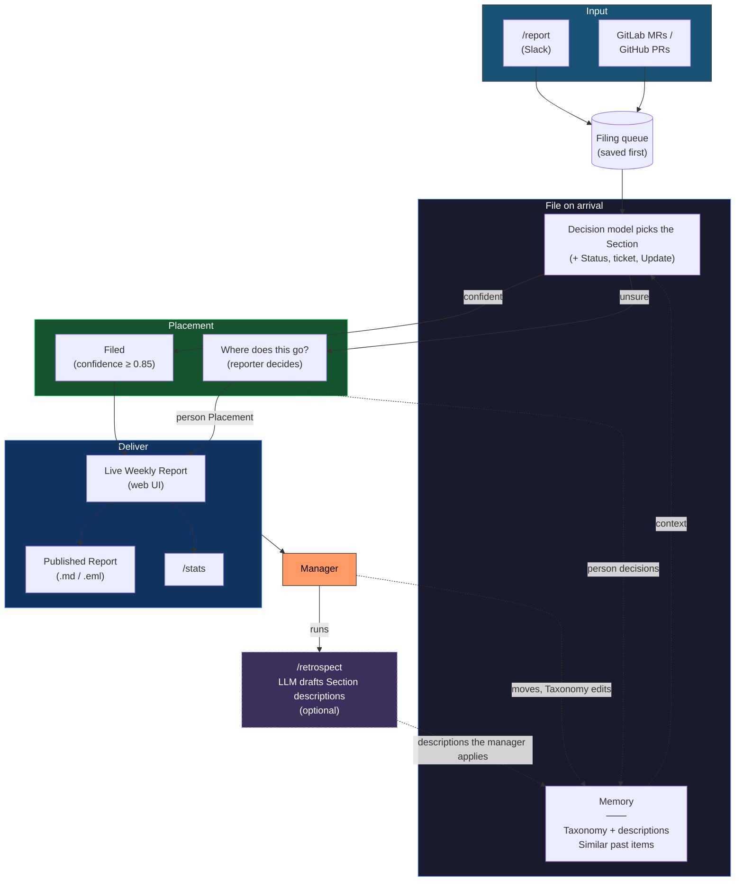

# ReportBot: Agentic AI Features Overview

## What Is ReportBot?

ReportBot is a Slack bot that collects Work Items from developers (`/report`) and from code hosting (GitLab MRs, GitHub PRs) and files each one into the team's Weekly Report **the moment it arrives**. The team watches a live report in the web UI; a manager publishes it at the end of the week. Terms used here (Work Item, Section, Placement, Taxonomy, Undetermined) are defined in [`CONTEXT.md`](../CONTEXT.md).

## The Problem We Solved

The first version classified everything in one batch at report time. Confidence was invented by code, corrections arrived too late to matter that week, and the Section list was re-parsed from last week's markdown, so renaming a heading broke history.

| Before | Now |
|--------|-----|
| Items classified in a batch when the report is generated | Each Work Item is filed when it arrives |
| Confidence assigned by code (0.90 by default) | Confidence is a calibrated probability from a decision model |
| Low-confidence items reviewed by the manager at report time | The reporter is asked "Where does this go?" right away |
| Sections re-parsed from the last report, positional IDs | Taxonomy in the database with stable IDs, edited in the web UI |
| Open items carried over as copied text | Open Work Items stay on every report until they are done |
| Glossary and guide files maintained beside the code | Section descriptions in the Taxonomy, suggested by `/retrospect` |
| Report visible only after generation | Live report in the web UI for the whole team |

---

## Agentic AI Features

### What Makes It "Agentic"?

1. **Memory** — every Placement, by the models or by a person, is kept and reused as context
2. **Self-evaluation** — every Section pick comes with a calibrated confidence that decides whether it is filed
3. **Knowing what it doesn't know** — below a confidence level it asks a person instead of guessing
4. **Self-improvement** — person decisions and corrections feed the next filing, and `/retrospect` proposes clearer Section descriptions

---

### Feature 1: Filing on Arrival

**What it does:** `/report` saves the Work Item, replies "Saved — filing it…" within Slack's 3-second limit, and queues a filing job. A background worker files it and updates the reply with the Section, the formatted report line, Status and tickets.

**Why it matters:** The reporter sees where the item landed while the context is fresh, and the team sees the report grow during the week.

**How it works:**
- The job is stored in the database together with the Work Item, so a crash or restart loses nothing
- Workers retry failures with backoff (5 attempts); after that the item is Undetermined and a 15-minute sweep re-queues it
- Fetched MRs/PRs go through the same queue; their questions go to the author by DM

---

### Feature 2: One Calibrated Decision per Work Item

**What it does:** A decision model (System One protocol) picks the Section as a Choice over the active Sections, and in the same request answers the narrow questions code cannot decide. The Choice's confidence is the Placement's confidence.

**Why it matters:** The decision model returns calibrated probabilities, so its confidence can gate what is filed without a person. On 592 past Work Items this filed about three times as many items at ≥ 90% accuracy as an LLM pick checked by the same model, with the same overall accuracy and half the calls.

**How it works:**
- One request per Work Item: the `section` Choice (criteria = each Section's path plus any manager-written description), with the 30 most similar past Work Items and where they were filed in `state`
- In the same request, only when code cannot decide: the Status, the ticket ID among several candidate numbers, and whether the report updates an Open Work Item
- Raw answers and probabilities are stored (`model_judgments`), so the threshold can be re-tuned without calling the model again

---

### Feature 3: Ask Instead of Guess

**What it does:** When the Section confidence is below `decision_model_confidence` (default 0.85), the Work Item waits in Undetermined and the reporter gets "Where does this go?" buttons for the decision model's three most likely Sections, plus Other….

**Why it matters:** The system acts alone only where it is reliable and hands the rest to the person who knows the answer. One click from the reporter is a person-decided Placement.

**How it works:**
- At 0.85, about 43% of items filed themselves at about 84% accuracy in the evaluation (0.91 reached 90% with 27% filed); for 88% of items the right Section is among the three buttons
- Likely Updates are always confirmed: "Looks like an update to …" [Update it] [It's new]
- A likely link between an MR and an Open Work Item is confirmed by the MR author by DM; only an exact ticket match links automatically

---

### Feature 4: Memory That Comes From People

**What it does:** Every Placement change is recorded in `placement_history` with who decided it — a model, the reporter, or a manager. Person decisions become the similar-item examples for future filing, and overrides of a model Placement are the corrections `/retrospect` studies.

**Why it matters:** The system learns the team's filing conventions from ordinary use — no retraining, no separate labelling step.

---

### Feature 5: Taxonomy as Living Data

**What it does:** Areas, Categories and Sections live in the database with stable IDs. Managers add, rename, reorder, split, merge and retire them in the web UI.

**Why it matters:** Renaming "7.4.5 release" to "7.4.6 release" no longer breaks history, and new Sections take effect immediately.

**How it works:**
- Every Taxonomy edit queues one re-filing of Open Work Items: the decision model picks again for each, and confident changes move
- If a person's choice is overridden, that person gets a DM with an Undo button

---

### Feature 6: Retrospective → Section Descriptions

**What it does:** `/retrospect` (manager-only) has the LLM study recent corrections and suggest a clearer one-line description for the Sections people keep correcting. Apply writes it to the Taxonomy; the decision model sees it on the next filing. This is the only use of an LLM, and it is optional.

**Why it matters:** Most mistakes happen between neighbouring Sections (e.g. two engineering areas whose items look alike). A precise description is the cheapest fix, and it is reviewed by a manager before it takes effect.

---

### Feature 7: Accuracy Dashboard (`/stats`)

**What it does:** Shows, for the week: items reported or fetched, how many were filed automatically and how many were asked, filing failures, items still Undetermined, and corrections by Section.

**Why it matters:** The confidence threshold was set from historical data; `/stats` is how the team checks it against real corrections and tunes it.

---

## Agentic Design Considerations

### Human-in-the-Loop by Default

- Nothing is filed silently unless the decision model is confident
- Updates and MR links are confirmed by a person; only exact ticket matches link automatically
- `done` is always a person's decision — a merged MR moves a Work Item to `in testing`, not `done`
- `/retrospect` suggestions take effect only when a manager applies them
- A person whose choice is overridden after a Taxonomy edit can undo it

### Graceful Degradation

- The Slack reply never waits for a model
- If the decision model is unreachable, the Work Item is Undetermined with a reason and retried; it is never lost
- Publishing calls no model; it renders what is already filed and warns about Undetermined items

### Trust and Identity

- Only a Work Item's author (by Slack user ID) or a manager can change it; display names are never trusted
- Fetched and imported Work Items get an owner only through the explicit `author_ids` map; code-hosting accounts are matched by numeric account ID
- Unmapped Work Items are manager-only

### Privacy and Cost

- The models are reached through configurable endpoints, so they can stay behind an internal gateway
- Similar-item retrieval is in-memory TF-IDF — no extra model calls
- Each Work Item costs one decision-model request; publishing costs none

---

## High-Level Architecture



Two loops close the system. The **reporter loop**: whenever the decision model is unsure, the reporter decides, and that decision becomes memory for the next item. The **manager loop**: moves, Taxonomy edits and `/retrospect` descriptions sharpen the context the decision model sees. Only confident answers are filed without a person.

---

## How It Improves Over Time

```
Week 1:  Many items are asked ("Where does this go?") — reporters click once each
Week 2:  Those clicks are now similar-item examples → more confident picks → fewer questions
Week 3:  /retrospect suggests descriptions for the two most-corrected Sections → manager applies
Week 4:  /stats shows real auto-filed accuracy → threshold re-tuned from production data
```

---

## What's Next

| Item | Value | Effort |
|------|-------|--------|
| **Re-tune the threshold** from 2–3 weeks of `/stats` corrections | More items filed without a question | Low |
| **Manager-written descriptions** for the most confused Sections | Fewer neighbouring-Section mistakes | Low |
| **Faster decision-model serving** (batching on the gateway) | Faster bulk re-filing | Medium |
| **Semantic embeddings** instead of TF-IDF for similar items | Better context for the decision model | Medium |
